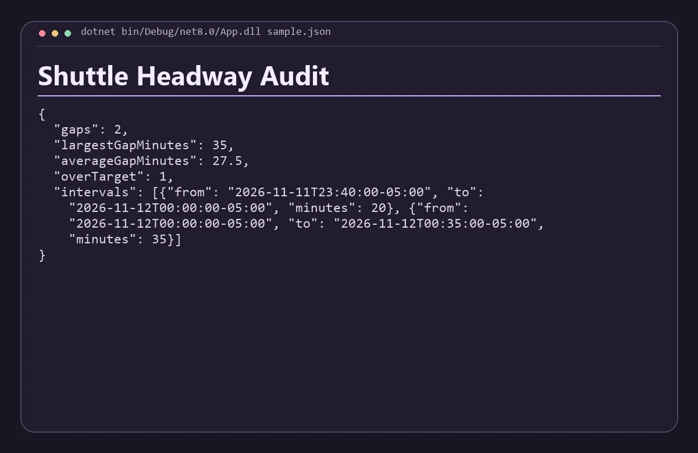

# Shuttle Headway Audit

Measure gaps and irregularity between scheduled shuttle departures, including overnight service.



## Run

Install .NET 8 SDK and runtime. Run these commands from the repository root.

```sh
dotnet build --nologo
dotnet bin/Debug/net8.0/App.dll sample.json
```

Replace `sample.json` with a JSON file following the same structure. The app prints a JSON report to standard output.

Provide ISO timestamps with explicit offsets and a target interval in minutes. The tool sorts actual instants and compares consecutive gaps.

## Verify

Run `python check.py` with Python 3.11 or newer after the build step when applicable. The check verifies the bundled scenario and confirms that an invalid input returns an error.
